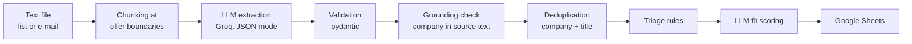

# job-agent


An LLM-powered pipeline that turns job-board listings and alert e-mails into structured, deduplicated and verified job offers, built as a portfolio project for data engineering with an LLM component.

> **Status:** work in progress. Version 1 (target: 30.11.2026) covers the full path from a text file to a scored list of offers in Google Sheets. The parts marked *done* below already work and are covered by tests.

## Why

Job alerts arrive as noisy, inconsistent text: the same offer is posted in several cities and categories, salaries come in different formats, and every portal lays out its e-mails differently. This project extracts offers from such text with an LLM, then uses plain, tested code to clean and **verify** what the model returned.

## Pipeline



| Stage | Status |
|---|---|
| Chunking at offer boundaries | done |
| LLM extraction with retries (invalid JSON, rate limits) | done |
| Schema validation | done |
| Grounding check | done |
| Deduplication | done |
| Extraction evaluation against hand-checked ground truth | done |
| CI (pytest on every push) | done |
| Rule-based triage (rules in YAML, flags for manual review) | done |
| LLM fit scoring | done |
| Google Sheets output (deduplicated against existing rows) | done |

## Evaluation

Extraction is measured against hand-verified expected results (`tests/eval/expected/`): every expected offer is classified as correct, wrong company, missing, or extra.

| Test list | Configuration | Correct | Wrong company | Precision | Recall |
|---|---|---|---|---|---|
| Poznań, compact format (14 offers) | without chunking | last offer lost in 3 of 4 runs | – | – | – |
| Poznań, compact format (14 offers) | chunking with overlap | 14/14 in 3 of 3 runs | 0 | 100% | 100% |
| Remote, raw format (32 offers) | fixed-size chunks with overlap | 23/32 | 10 | 68% | 72% |
| Remote, raw format (32 offers) | fixed-size chunks + grounding, verified offers only | 23/32 | **0** | **100%** | 72% |
| Remote, raw format (32 offers) | **chunks cut at offer boundaries** | **29–30/32** (2 runs) | 2 | **94%** | **91–94%** |

Among offers that passed the grounding check, precision was 100% in both runs. Both wrong-company offers in the last row were flagged as uncertain by the grounding check, so no offer with a wrong company is reported as verified.

**Key results:**
- The grounding check flagged exactly the 11 wrong offers and none of the correct ones, raising precision from 68% to 100% with no loss of recall.
- A controlled experiment showed that an offer ending exactly at a chunk boundary was always dropped (0/2 runs at the end of a chunk, 2/2 in the middle). Cutting chunks only between offers raised recall from 72% to 94% and cut wrong company assignments from 10 to 2.

Limitations: the test set is small (46 unique offers) and LLM output varies between runs; the remote-list figures come from one or two runs.

## Design decisions

- **Chunking at offer boundaries.** Long lists are split into chunks of up to 40 lines, cut only where an offer ends (a standalone "Full-time" line in raw lists, a blank line in compact lists, "Aplikuj" in e-mails). Every offer lands whole in exactly one chunk. Fixed-size chunks with overlap are kept only as a fallback for text with no detectable boundaries. Longer chunks were tested and rejected: at 60 lines the model started dropping offers (9/14).
- **Verification in code, not in the prompt.** The model sometimes attaches an offer to the neighbouring company. Instead of asking the model to be more careful, a deterministic check confirms that the company appears in the source text just above the job title. Offers that fail are flagged as uncertain.
- **Triage before the LLM.** Cheap, deterministic rules in `config/triage.yaml` reject offers that are clearly out of scope (analyst roles, SAP, security, leadership, B2B-only, UoP salary below threshold) before any LLM scoring. Rules reject only on a clear signal; missing data means the offer passes. Unclear cases (e.g. classic ML frameworks in tags) are flagged for manual review instead of rejected. On 41 hand-labelled offers, triage keeps all 5 good ones and rejects 18 of 36 bad ones.
- **Role direction first, score band enforced in code.** The model first classifies the role as target (data, analytics or AI engineering), adjacent or other, and only then scores skill overlap within that band (60–100, 25–55, 0–25). Code clamps the score to the band, so a full-stack offer with many matching tags cannot outrank a data engineering role. Without bands, the first version scored a full-stack role equal to a GenAI role, and the same offer posted twice got 30 and 58.
- **Deduplication by company + title.** The same offer is published under several URLs, so URLs cannot identify it.
- **Missing data means "unknown".** An offer without a salary range is not treated as underpaid.
- **No scraping.** Input comes from e-mail alerts and text the user provides, in line with job-board terms of service.
- **Free tier only.** Groq's free API tier, with handling for its per-minute token limits.


## Project structure

```
job_agent/         pipeline code
  chunk.py         splitting text into chunks at offer boundaries
  extract.py       LLM extraction + validation + grounding
  grounding.py     checking the company against the source text
  dedup.py         normalisation and deduplication
  evaluate.py      comparison with expected results
  llm.py           Groq client with retries
  limits.py        reading Groq rate-limit messages
  models.py        Offer and Scores data model
  score.py         LLM fit scoring, clamped to the role's score band
  sheets.py        Google Sheets output, skips offers already in the sheet
  triage.py        rule-based triage (rules in config/triage.yaml)
config/            triage rules
prompts/           LLM prompts
scripts/           evaluation and smoke tests (call the real API)
tests/             unit tests (no API calls) and evaluation data
```

## Running locally

Requires Python 3.14 and a free [Groq](https://console.groq.com) API key.

```bash
python -m venv .venv
.venv\Scripts\activate            # Windows; on Linux/macOS: source .venv/bin/activate
pip install -r requirements.txt
```

Create a `.env` file (see `.env.example`):

```
GROQ_API_KEY=...
GROQ_MODEL=openai/gpt-oss-120b
GOOGLE_CREDENTIALS_FILE=service-account.json
SHEET_ID=...
```

Fit scoring reads a skills profile from `profile/skills.yaml`, which is personal and not part of the repo. To try it, copy the example profile:

```bash
mkdir profile
copy tests\fixtures\skills_example.yaml profile\skills.yaml    # Windows; on Linux/macOS: cp tests/fixtures/skills_example.yaml profile/skills.yaml
```

Writing to Google Sheets needs a Google Cloud service account (no billing required): download its JSON key as `service-account.json` into the project folder, share your spreadsheet with the service account's e-mail as an editor, add an empty tab named `oferty`, and set `SHEET_ID` in `.env` (the part of the sheet URL between `/d/` and `/edit`). The header row is created on the first run.

Extract, triage and score offers from a text file, then append new ones to the sheet:

```bash
python -m job_agent tests/fixtures/jjit_poznan_2026-11-03.txt
```

To try it without Google Sheets, add `--no-sheet`: results are only printed.

Evaluate extraction against the expected results (uses the API; the remote list costs roughly a quarter of the daily free-tier token limit per run):

```bash
python -m scripts.eval_extraction tests/fixtures/jjit_poznan_2026-11-03.txt --runs 3
```

Run the unit tests (no API key needed):

```bash
python -m pytest -v
```

## Roadmap

- **v1 (30.11.2026):** single end-to-end command, scheduled background runs.
- **v1.5:** Gmail API (read-only) as an input source, CV draft per offer.
- **Later:** BigQuery storage, Airflow and dbt.
