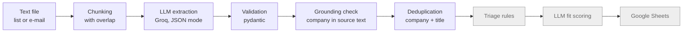

# job-agent


An LLM-powered pipeline that turns job-board listings and alert e-mails into structured, deduplicated and verified job offers, built as a portfolio project for data engineering with an LLM component.

> **Status:** work in progress. Version 1 (target: 30.11.2026) covers the full path from a text file to a scored list of offers in Google Sheets. The parts marked *done* below already work and are covered by tests.

## Why

Job alerts arrive as noisy, inconsistent text: the same offer is posted in several cities and categories, salaries come in different formats, and every portal lays out its e-mails differently. This project extracts offers from such text with an LLM, then uses plain, tested code to clean and **verify** what the model returned.

## Pipeline



| Stage | Status |
|---|---|
| Chunking with overlap | done |
| LLM extraction with retries (invalid JSON, rate limits) | done |
| Schema validation | done |
| Grounding check | done |
| Deduplication | done |
| Extraction evaluation against hand-checked ground truth | done |
| CI (pytest on every push) | done |
| Rule-based triage | planned |
| LLM fit scoring | planned |
| Google Sheets output | planned |

## Evaluation

Extraction is measured against hand-verified expected results (`tests/eval/expected/`): every expected offer is classified as correct, wrong company, missing, or extra.

| Test list | Configuration | Correct | Wrong company | Precision | Recall |
|---|---|---|---|---|---|
| Poznań, compact format (14 offers) | without chunking | last offer lost in 3 of 4 runs | – | – | – |
| Poznań, compact format (14 offers) | chunking with overlap | 14/14 in 3 of 3 runs | 0 | 100% | 100% |
| Remote, raw format (32 offers) | chunking, all offers | 23/32 | 10 | 68% | 72% |
| Remote, raw format (32 offers) | **chunking + grounding, verified offers only** | 23/32 | **0** | **100%** | 72% |

**Key result:** the grounding check flagged exactly the 11 wrong offers and none of the correct ones, raising precision from 68% to 100% with no loss of recall.

Limitations: the test set is small (46 unique offers) and LLM output varies between runs; the remote-list figures come from single runs.

## Design decisions

- **Chunking with overlap.** Long lists are split into 40-line chunks that overlap by 10 lines, so every offer appears whole in at least one chunk. Duplicates created by the overlap are removed by deduplication.
- **Verification in code, not in the prompt.** The model sometimes attaches an offer to the neighbouring company. Instead of asking the model to be more careful, a deterministic check confirms that the company appears in the source text just above the job title. Offers that fail are flagged as uncertain.
- **Deduplication by company + title.** The same offer is published under several URLs, so URLs cannot identify it.
- **Missing data means "unknown".** An offer without a salary range is not treated as underpaid.
- **No scraping.** Input comes from e-mail alerts and text the user provides, in line with job-board terms of service.
- **Free tier only.** Groq's free API tier, with handling for its per-minute token limits.

## Project structure

```
job_agent/         pipeline code
  chunk.py         splitting text into overlapping chunks
  extract.py       LLM extraction + validation + grounding
  grounding.py     checking the company against the source text
  dedup.py         normalisation and deduplication
  evaluate.py      comparison with expected results
  llm.py           Groq client with retries
  limits.py        reading Groq rate-limit messages
  models.py        Offer data model
prompts/           LLM prompts
scripts/           evaluation and smoke tests (call the real API)
tests/             unit tests (no API calls) and evaluation data
```

## Running locally

Requires Python 3.14 and a free [Groq](https://console.groq.com) API key.

```bash
python -m venv .venv
.venv\Scripts\activate            # Windows; on Linux/macOS: source .venv/bin/activate
pip install -r requirements.txt
```

Create a `.env` file (see `.env.example`):

```
GROQ_API_KEY=...
GROQ_MODEL=openai/gpt-oss-120b
```

Extract offers from a text file:

```bash
python -m job_agent tests/fixtures/jjit_poznan_2026-11-03.txt
```

Evaluate extraction against the expected results (uses the API; the remote list costs roughly a quarter of the daily free-tier token limit per run):

```bash
python -m scripts.eval_extraction tests/fixtures/jjit_poznan_2026-11-03.txt --runs 3
```

Run the unit tests (no API key needed):

```bash
python -m pytest -v
```

## Roadmap

- **v1 (30.11.2026):** triage rules tested against hand-labelled offers, LLM fit scoring, Google Sheets output, single end-to-end command.
- **v1.5:** Gmail API (read-only) as an input source, scheduled runs in GitHub Actions, CV draft per offer.
- **Later:** BigQuery storage, Airflow and dbt.
